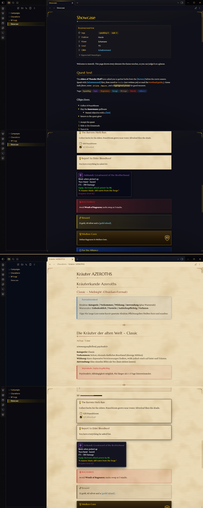

# WoW - Warcraft UI

### A World of Warcraft Interface Theme for Obsidian

> *Bring the authentic World of Warcraft game interface, questlog parchment, and item tooltips to your Obsidian vault.*

**WoW - Warcraft UI** is a comprehensive fantasy interface theme engineered for roleplayers, worldbuilders, game masters, and lorekeepers. Built with authentic Blizzard typography, custom SVG ornaments, quest markers, and deep **Style Settings** integration.



---

## ⚔️ Dual Mode Aesthetic

* **Dark Mode — "Interface":** Black-iron frames, burnished gold trim, and tooltip-navy note backgrounds reminiscent of in-game character frames and tooltips.
* **Light Mode — "Quest Log":** Rich, warm questlog parchment held within gilded iron frames, rendered with antique manuscript typography.

---

## ⚙️ Style Settings Integration

Install the [Style Settings](https://github.com/mgmeyers/obsidian-style-settings) community plugin for instant customization under **Settings → Style Settings → Azeroth**:

| Setting | Options / Description |
| :--- | :--- |
| **Faction** | Neutral (black iron & gold) · Alliance (navy & gold) · Horde (rusted iron & blood red) |
| **Quest-log pages in dark mode** | Toggle parchment page backgrounds while keeping dark iron borders |
| **Link color** | Spell link (light blue), Rare (blue), Epic (purple), Legendary (orange), or Quest (yellow) |
| **Hide `[brackets]`** | Cleans up bracket decorations around internal links |
| **Hide frame ornaments** | Removes gilded decorative corner accents |
| **Plain interface font** | Revert system menus to your default font while retaining Warcraft typography for notes |

---

## 📜 Custom Callouts

Bring your campaign notes and session logs to life with dedicated Warcraft callout boxes:

| Callout Syntax | Description & Aesthetic |
| :--- | :--- |
| `> [!quest] Title` | Parchment quest card with an iconic glowing yellow **!** |
| `> [!turnin] Title` | Quest completion card with a yellow **?** |
| `> [!gossip] NPC Name` | NPC dialogue box on aged parchment |
| `> [!item\|epic] Name` | In-game item tooltip (`poor`, `common`, `uncommon`, `rare`, `epic`, `legendary`, `artifact`, `heirloom`) |
| `> [!boss] / [!raid]` | Encounter journal entry with blood-red and gold accents |
| `> [!loot] / [!reward]` | Golden loot drop card |
| `> [!achievement\|10] Name` | Achievement toast frame displaying earned points |
| `> [!alliance] / [!horde]` | Faction banners with faction crests and colors |
| `> [!say] Character` | In-game chat line (`say`, `yell`, `whisper`, `party`, `guild`, `officer`, `emote`, `system`, `npc`) |

> Inside item tooltips (`[!item|...]`), use `==text==` for green stat/effect lines, `*text*` for gold flavor quotes, and `~~text~~` for red requirement text!

---

## 🎯 Tasks & Quest Objectives

Standard markdown tasks transform into questlog tracking marks:
```md
- [ ] Incomplete objective
- [x] Completed objective (golden checkmark)
- [!] Quest available (yellow exclamation mark)
- [?] Ready to turn in (yellow question mark)
- [-] Abandoned / failed quest (crimson cross)
```

---

## 💎 Item Quality & Class Colors

### Quality Tags & Inline Badges
Tags matching item qualities automatically glow with official Blizzard rarity colors:
- `#poor` / `#schlecht` · `#common` / `#verbreitet` · `#uncommon` / `#selten`
- `#rare` / `#rar` · `#epic` / `#episch` · `#legendary` / `#legendär`
- `#artifact` / `#artefakt` · `#heirloom` / `#erbsware` / `#erbstück`

Use inline HTML for item links:
```html
<span class="q-epic">[Ashkandi, Greatsword of the Brotherhood]</span>
<span class="q-legendary">[Thunderfury, Blessed Blade of the Windseeker]</span>
```

### Class Colors
Tags and inline classes glow with their official class colors:
- English: `#warrior`, `#paladin`, `#hunter`, `#rogue`, `#priest`, `#deathknight`, `#shaman`, `#mage`, `#warlock`, `#monk`, `#druid`, `#demonhunter`, `#evoker`
- German: `#Krieger`, `#Paladin`, `#Jäger`, `#Schurke`, `#Priester`, `#Todesritter`, `#Schamane`, `#Magier`, `#Hexenmeister`, `#Mönch`, `#Druide`, `#Dämonenjäger`, `#Rufer`

```html
<span class="c-mage">Jaina Proudmoore</span>
<span class="c-shaman">Thrall</span>
```

---

## 📊 XP Bar & Chatlog View

### XP Progress Bar
Native HTML progress bars render as authentic golden XP gauges:
```html
<progress value="65" max="100"></progress>
```

### Chatlog CSS Class
Add `cssclasses: chatlog` to any note's YAML frontmatter to format the note with authentic chat frame styling (with `*text*` rendered in emote orange).

---

## 📥 Installation

### Manual Installation
1. Download `theme.css` and `manifest.json` from the repository.
2. In your Obsidian vault, navigate to `.obsidian/themes/`.
3. Create a folder named `WoW - Warcraft UI` and place both files inside.
4. In Obsidian, open **Settings → Appearance → Themes** and select **WoW - Warcraft UI**.

---

## 📖 Showcase Note

Check out [SHOWCASE.md](SHOWCASE.md) inside this repository for a complete live demonstration note showcasing every feature, tag, callout, and font setting.

---

## 🛡️ Disclaimer

This is an independent, non-commercial fan-created theme for Obsidian. "Warcraft" and "World of Warcraft" are trademarks or registered trademarks of Blizzard Entertainment, Inc. This project is not affiliated with, endorsed, or sponsored by Blizzard Entertainment, Inc.

---

## 📄 License

Distributed under the [MIT License](LICENSE).
